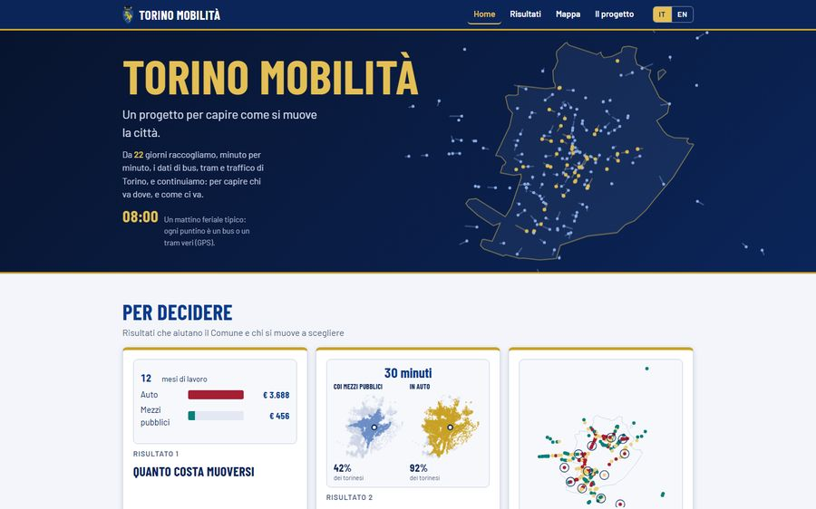
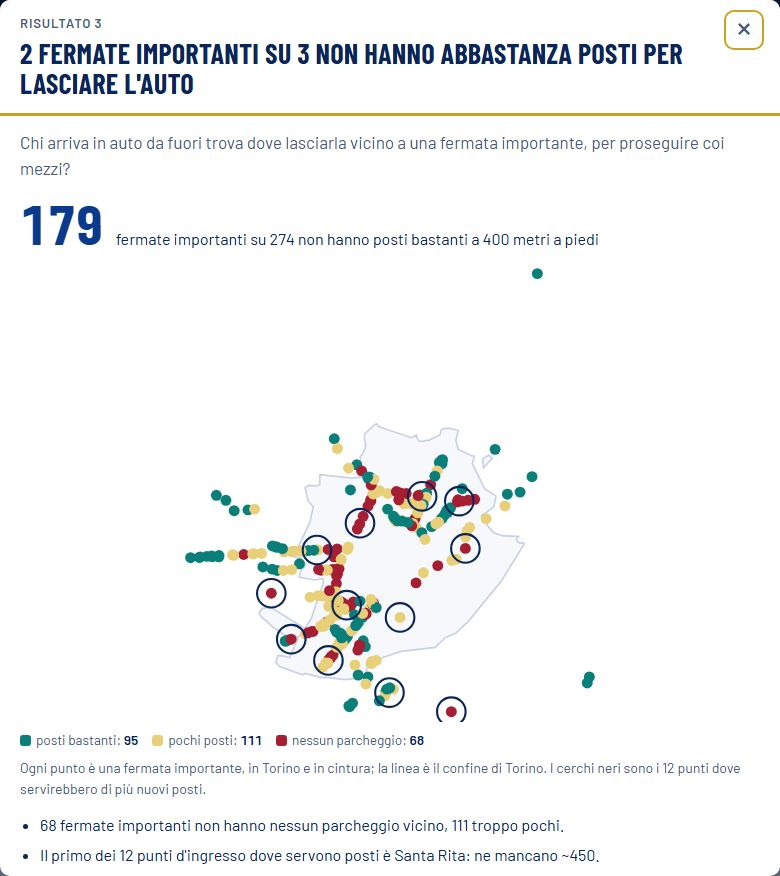

# Torino Mobilità

[](https://github.com/campeseleonardo-tech/Turin-mobility/actions/workflows/controllo.yml)
[](LICENSE)

*Italiano · [English below](#turin-mobility-english)*

**Come si muove Torino, letto dai dati veri.** Un progetto personale di analisi dei dati: chi va dove, dove mancano servizi, dove il trasporto pubblico fa fatica.
Un Raspberry Pi di casa raccoglie ogni minuto la posizione di bus e tram e i sensori del traffico; una mappa e sei risultati raccontano cosa ne esce.

**Il sito: <https://campeseleonardo-tech.github.io/Turin-mobility/>**

| Home | Un risultato | La mappa |
|---|---|---|
|  |  |  |

## I sei risultati

<!-- RISULTATI-IT:INIZIO -->
1. **Per andare al lavoro in centro l'auto costa circa 270 euro al mese più dei mezzi pubblici**  
   Quanto costa andare in centro in auto e quanto coi mezzi pubblici, oggi? → **269 euro** in più al mese per andare al lavoro in centro in auto invece che coi mezzi pubblici. Col costo pieno dell'auto sono ~366 euro. [Apri](https://campeseleonardo-tech.github.io/Turin-mobility/r/1.html)
2. **Al mattino, coi mezzi pubblici si impiega 1,9 volte il tempo dell'auto**  
   Al mattino, quanto ci si mette in più coi mezzi pubblici che in auto? → **1,9 volte** il tempo dell'auto, per un viaggio tipico del mattino. [Apri](https://campeseleonardo-tech.github.io/Turin-mobility/r/2.html)
3. **2 fermate importanti su 3 non hanno abbastanza posti per lasciare l'auto**  
   Chi arriva in auto da fuori trova dove lasciarla vicino a una fermata importante, per proseguire coi mezzi? → **179** fermate importanti su 274 non hanno posti bastanti a 400 metri a piedi. [Apri](https://campeseleonardo-tech.github.io/Turin-mobility/r/3.html)
4. **Circa 1 torinese su 10 vive in una zona con più difficoltà sociali e pochi servizi**  
   Chi vive dove i servizi sono pochi e le difficoltà sociali sono alte? → **79.598** residenti in zone con più difficoltà sociali e servizi bassi: il 9,5% dei residenti delle zone abitate. È 1,7 volte quanto ci si aspetterebbe per caso. [Apri](https://campeseleonardo-tech.github.io/Turin-mobility/r/4.html)
5. **Circa il 6% dei passaggi arriva con più di 10 minuti di ritardo**  
   Quanto spesso i mezzi GTT arrivano in ritardo o a coppie? → **6,41%** dei passaggi feriali arriva con oltre 10 minuti di ritardo. [Apri](https://campeseleonardo-tech.github.io/Turin-mobility/r/5.html)
6. **Torino, città dei 15 minuti: quasi tutti hanno i servizi a 15 minuti a piedi**  
   Quanti torinesi hanno i servizi a 5, 10 e 15 minuti a piedi, e quanti vivono su una strada trafficata? → **99,2%** dei residenti delle zone abitate ha tutti e 5 i servizi a 15 minuti a piedi. [Apri](https://campeseleonardo-tech.github.io/Turin-mobility/r/6.html)
<!-- RISULTATI-IT:FINE -->

Ogni numero porta la sua etichetta: **misurato** (sensori, GPS dei mezzi), **programmato** (orario ufficiale), **stimato** (calcolo mio su dati veri), **censimento**.
Ogni risultato dichiara i suoi limiti nella sua scheda.

## Come è fatto

- **Raccolta**: un Raspberry Pi (Python, SQLite) legge ogni minuto la posizione dei mezzi GTT, i ritardi e i sensori 5T del traffico e dei parcheggi.
- **Calcoli**: script Python numerati in `scripts/` (numpy, scipy, pandas, r5py per i percorsi in trasporto pubblico). Per ogni risultato c'è un documento in `docs/` (domanda, criteri, numeri, limiti).
- **Pagine**: HTML e JavaScript senza librerie; i dati arrivano da file `.js` scritti dagli script. La mappa e le schede stanno in `mappa_torino.html` e `risultati.html`.
- **Metodo di lavoro**: codice e documenti scritti con l'aiuto di Claude, un assistente di intelligenza artificiale; scelte, controlli e dati sono di Leo.
- **Appunti di lavoro** in `sviluppo/`: i piani dei giri di lavoro (`sviluppo/piani/`), la memoria del progetto, la tesi e le prove di stile. Sono appunti scritti mentre si lavora, non documentazione: quella sta in `docs/`.

## Fonti e licenze

Solo dati aperti. Il codice ha licenza [MIT](LICENSE); i dati mantengono la licenza della loro fonte (tabella completa in [`docs/FONTI_DATI.md`](docs/FONTI_DATI.md)).

- GTT: orari (GTFS) e tempo reale (GTFS-RT), CC BY, via aperTO.
- 5T (Muoversi a Torino): flussi di traffico, parcheggi, ZTL; IODL 2.0.
- ISTAT: censimento 2021 e basi territoriali, CC BY 4.0.
- Comune di Torino (aperTO): catalogo dei servizi, zone, fermate della metro, CC BY 4.0.
- Agenzia della mobilità piemontese: indagine sugli spostamenti IMQ 2022; Agenzia delle Entrate: quotazioni OMI. Licenza non chiara: **non ripubblicati**, si scaricano dalla fonte.
- © contributori di OpenStreetMap (ODbL). Sfondi della mappa: Esri, Maxar, Earthstar Geographics.

## Come rifare i calcoli

```
pip install -r requirements.txt     # per i tempi coi mezzi pubblici (r5py) serve anche Java 21 o più (JAVA_HOME o java nel PATH)
python scripts/scarica_dati.py      # dati grandi dalla Release di GitHub (IMQ e OMI a mano: vedi docs/DATI.md)
python scripts/rifai_tutto.py       # tutto, nell'ordine giusto; si ferma e riprende con --riprendi (--elenco mostra le fasi)
```

IMQ 2022 e OMI si scaricano a mano dalla fonte: indirizzi in [`docs/FONTI_DATI.md`](docs/FONTI_DATI.md); poi `python scripts/rifai_tutto.py --da dati`. Le pagine funzionano senza (la mappa li ha già dentro, con la fonte citata); i calcoli che li usano si fermano con un messaggio che dice cosa scaricare.

Solo le pagine: `python scripts/rifai_tutto.py --solo schede,mappa`. Controllo delle pagine: `python scripts/prova_pagine.py`.

## Chi sono

Leonardo Campese. Nel 2020 la mia tesi triennale (*The effects and applications of Industry 4.0 on Smart Cities*) prometteva che sensori e dati avrebbero cambiato le città;
questo progetto è la verifica, sui dati veri di Torino.
[LinkedIn](https://www.linkedin.com/in/leocampese/) · [campese.leonardo@gmail.com](mailto:campese.leonardo@gmail.com)

---

# Turin Mobility (English)

*[Italiano sopra](#torino-mobilità)*

**How Turin moves, read from real data.** A personal data-analysis project: who travels where, where services are missing, where public transport struggles.
A Raspberry Pi at home collects the position of buses and trams and the traffic sensors every minute; a map and six results show what comes out of it.
The site is in Italian and English (button IT/EN); the map is in Italian.

**The site: <https://campeseleonardo-tech.github.io/Turin-mobility/>**

## The six results

<!-- RISULTATI-EN:INIZIO -->
1. **Going to work in the centre costs about 270 euros a month more by car than by public transport**  
   How much does it cost to go to the centre by car and by public transport, today? → **269 euros** more a month to go to work in the centre by car instead of by public transport. At the car's full cost it is ~366 euros. [Open](https://campeseleonardo-tech.github.io/Turin-mobility/r/1.html)
2. **In the morning, public transport takes 1.9 times as long as the car**  
   In the morning, how much longer does it take by public transport than by car? → **1.9 times** the car's travel time, for a typical morning trip. [Open](https://campeseleonardo-tech.github.io/Turin-mobility/r/2.html)
3. **2 in 3 important stops lack enough spaces to leave the car**  
   Can people driving in from outside find a place to leave the car near an important stop, and continue by public transport? → **179** important stops out of 274 lack enough parking within 400 metres on foot. [Open](https://campeseleonardo-tech.github.io/Turin-mobility/r/3.html)
4. **About 1 Turin resident in 10 lives in an area with more social difficulties and few services**  
   Who lives where services are few and social difficulties are high? → **79,598** residents in zones with more social difficulty and few services: 9.5% of residents of inhabited zones. That is 1.7 times what you would expect by chance. [Open](https://campeseleonardo-tech.github.io/Turin-mobility/r/4.html)
5. **About 6% of stop passages are more than 10 minutes late**  
   How often are GTT vehicles late or bunched together? → **6.41%** of weekday arrivals are more than 10 minutes late. [Open](https://campeseleonardo-tech.github.io/Turin-mobility/r/5.html)
6. **Turin, a 15-minute city: almost everyone has the services within a 15-minute walk**  
   How many people in Turin have the services within 5, 10 and 15 minutes on foot, and how many live on a busy road? → **99.2%** of residents of inhabited areas have all 5 services within a 15-minute walk. [Open](https://campeseleonardo-tech.github.io/Turin-mobility/r/6.html)
<!-- RISULTATI-EN:FINE -->

Every number carries a label: **measured** (sensors, vehicle GPS), **scheduled** (official timetable), **estimated** (my calculation on real data), **census**.
Each result states its limits on its own card.

## How it is built

- **Collection**: a Raspberry Pi (Python, SQLite) reads the position of GTT vehicles, delays and the 5T traffic and parking sensors every minute.
- **Calculations**: numbered Python scripts in `scripts/` (numpy, scipy, pandas, r5py for public-transport routing). Each result has a document in `docs/` (question, criteria, numbers, limits).
- **Pages**: plain HTML and JavaScript, no libraries; data come from `.js` files written by the scripts.
- **Way of working**: code and documents written with the help of Claude, an AI assistant; choices, checks and data are Leo's.
- **Working notes** in `sviluppo/` (Italian): the plans of each work round (`sviluppo/piani/`), the project memory, the thesis and style tests. They are notes written while working, not documentation: that is in `docs/`.

## Sources and licences

Open data only. The code is under the [MIT licence](LICENSE); the data keep the licence of their source (full table in [`docs/FONTI_DATI.md`](docs/FONTI_DATI.md), Italian).

- GTT: timetables (GTFS) and real time (GTFS-RT), CC BY, via aperTO.
- 5T (Muoversi a Torino): traffic flows, parking, restricted traffic zones; IODL 2.0.
- ISTAT: 2021 census and territorial bases, CC BY 4.0.
- City of Turin (aperTO): service catalogue, zones, metro stops, CC BY 4.0.
- Piedmont Mobility Agency: 2022 travel survey (IMQ); Revenue Agency: OMI price quotes. Licence unclear: **not republished**, download them from the source.
- © OpenStreetMap contributors (ODbL). Map backgrounds: Esri, Maxar, Earthstar Geographics.

## Rebuild the calculations

```
pip install -r requirements.txt
python scripts/scarica_dati.py      # large data from the GitHub Release (IMQ and OMI by hand: see docs/DATI.md)
python scripts/rifai_tutto.py       # everything, in the right order; stops and resumes with --riprendi (--elenco lists the steps)
```

IMQ 2022 and OMI are downloaded by hand from the source: addresses in [`docs/FONTI_DATI.md`](docs/FONTI_DATI.md); then `python scripts/rifai_tutto.py --da dati`. The pages work without them (the map already contains them, with the source cited); the calculations that use them stop with a message saying what to download.

Pages only: `python scripts/rifai_tutto.py --solo schede,mappa`. Page checks: `python scripts/prova_pagine.py`.

## About me

Leonardo Campese. In 2020 my bachelor's thesis (*The effects and applications of Industry 4.0 on Smart Cities*) promised that sensors and data would change cities;
this project is the check, on real data from Turin.
[LinkedIn](https://www.linkedin.com/in/leocampese/) · [campese.leonardo@gmail.com](mailto:campese.leonardo@gmail.com)
